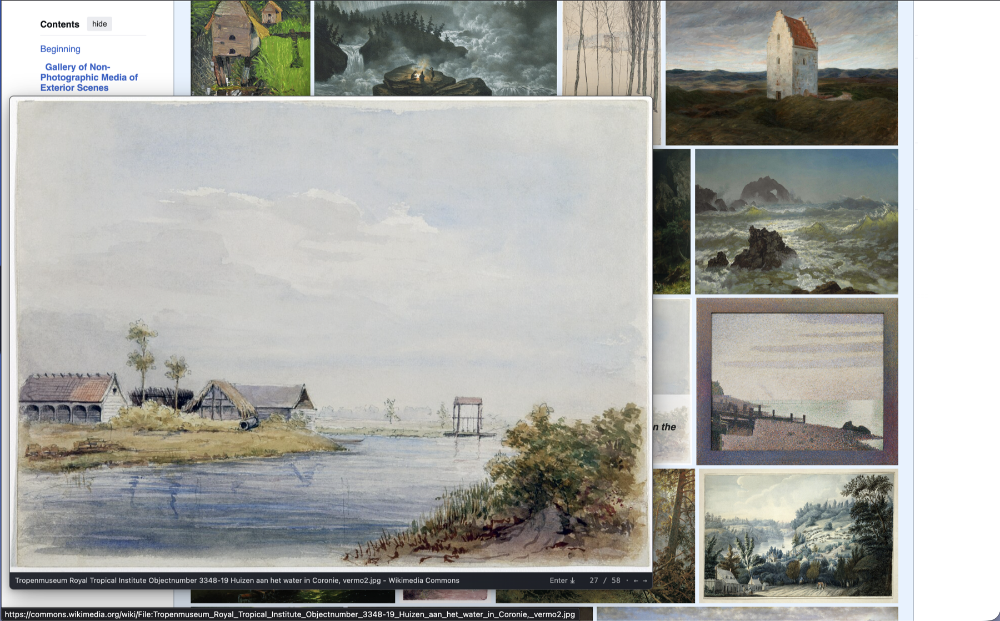

# OpenHoverZoom


Hover over a thumbnail or media link to preview the full-size image, video, or
audio without leaving the page. Use the arrow keys to browse galleries. Press
Enter to download the visible image; you can change this shortcut in the options.
Hold Ctrl to temporarily hide and disable previews. Both shortcuts are customizable
in the options.



## Privacy

OpenHoverZoom has no tracking, analytics, accounts, ads, or backend. It does not
download executable code or remote rules, and settings stay in your browser.

The extension needs access to visited pages to inspect thumbnails and load
larger media. No browsing activity, page content, form data, or credentials are
collected or sent to OpenHoverZoom.

## Run it locally

You need [Node.js](https://nodejs.org/) 22 or newer and a Chromium browser such
as Brave or Chrome.

Install the dependencies and build the extension:

```sh
npm install
npm run build
```

Open `brave://extensions` or `chrome://extensions`, enable **Developer mode**,
choose **Load unpacked**, and select the generated `dist` folder.

After changing the code, rebuild, reload the extension, and refresh the page you
are testing.

To run all automated checks:

```sh
npm run check
```

## License

MIT. See [LICENSE](LICENSE).
